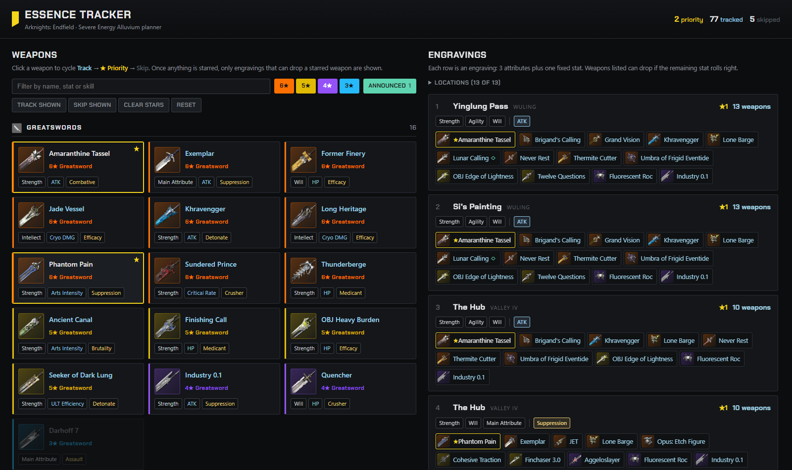
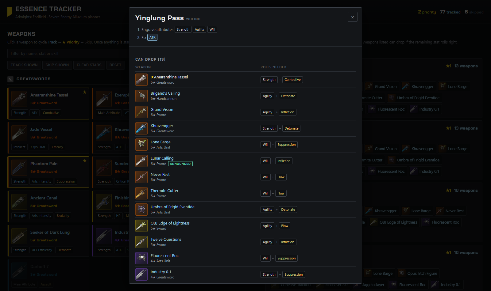

# Arknights: Endfield Essence Tracker

Pick the weapons you want Flawless Essences for, and the tracker lists the Severe Energy Alluvium engravings that can drop the most of them.

**[Open the Essence Tracker](https://nakomaru.github.io/essencetracker/)**

## Preview

### Weapons and engravings


### Engraving details


## How to use
1. Click weapons to cycle **Track** → **★ Priority** → **Skip**. 4–6★ weapons start tracked and 3★ weapons start skipped.
2. The **Engravings** list ranks each location's engravings by how many priority weapons, then tracked weapons, they can drop. Once anything is starred, only engravings that can drop a starred weapon are shown.
3. Each row shows the 3 attributes to engrave and the stat to fix. An **any** slot means every choice there drops the same tracked weapons.
4. Click a row to see, per weapon, which rolls it still needs.
5. Under **Locations**, hide areas you haven't unlocked.

Engravings that only differ in untracked outcomes are merged into one row, and rows that are strictly worse than another row at the same location are dropped.

Weapons that are announced but not yet released are tracked like the rest, so their essences can be farmed ahead of time. They carry an **Announced** tag, a striped rarity edge and a dashed outline, and their stats come from preview game data that can change before release. The rarity filters cover released weapons and the **Announced** filter covers announced ones, so turning off every rarity shows only announced weapons; **Skip shown** then drops them from the results.

## Development

The site is plain static files with no build step. Development tooling needs Node 22+.

```sh
npm install          # Playwright, for browser tests and screenshots
npm run serve        # http://127.0.0.1:8000/ (data.json is fetched, so file:// won't work)
npm test             # solver, sync, deduction and data tests
npm run test:e2e     # browser tests in the installed Chrome
npm run previews     # regenerate the README screenshots
npm run sync         # update data.json and icons from game data
```

### Data

`data.json` is generated from the datamined game data published by [cmyyx/cep](https://github.com/cmyyx/cep): weapons, their English names and skill text, the stat names, and each Severe Energy Alluvium location's attribute, secondary and skill pools. Icons in `images/weapons/` come from the same source.

- Weapons, locations and stats are keyed by game id (`wpn_sword_0025`, `world_energy_point_group13`, `gat_passive_attr_atk`), and `stats` maps each stat id to its in-game name. Saved selections are keyed by id, so renames don't lose them.
- `npm run sync` reads every file from one cep commit, recorded under `source`, and prints what changed. `node tools/sync.js --dry-run` previews the changes without writing.
- Weapons cep links to a signature operator (most limited 6★ weapons and a few 5★) list the operator's English name under `operators`, from cep's character name tables. Search matches operator names.
- A weapon cep marks as preview gets `announced: true`; the next sync after its release removes it. A weapon or location whose English name changes keeps its old name under `formerly`, which search and older saved selections still match.
- Nothing in `data.json` is edited by hand. A sync that finds an unknown weapon type or a stat without an English name stops instead of guessing.

### Deductions

Announced weapons often arrive before their skill text. The game's full text table, published by [cmyyx/cep-assets](https://github.com/cmyyx/cep-assets), can still hold the answer without linking it to the weapon, such as a weapon skill name that no released weapon uses, or the English name of an operator cep's character tables don't cover yet. `tools/deduce.js` holds the rules that find these, and the sync fetches the text table only while some data is missing.

The rules only propose. A reviewer weighs each proposal and records a verdict in `tools/deductions.json`: `accepted` or `rejected`, the `basis` shown to users, and `review` notes on the evidence and residual risk. The sync then prints:

- `CANDIDATE`: a proposal without a verdict. Nothing is published until one is recorded.
- `REVIEW`: a verdict the rules no longer support, because the evidence changed. It is held back until reviewed again.
- `RESOLVED`: the game data has filled the gap. The deduction is dropped; compare it with the real data and retire the verdict.

Accepted deductions appear under the weapon's `deduced`, and the site lists them after the skill text, each with its basis, under "Deduced, not confirmed by the game data".
